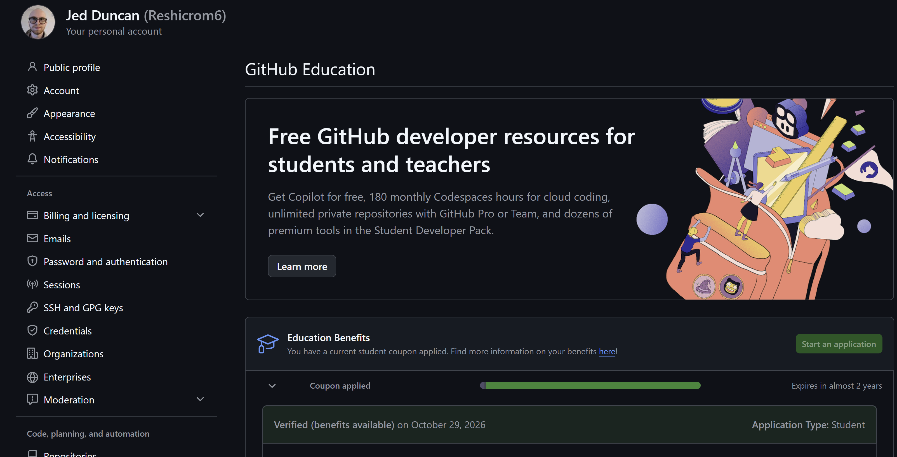
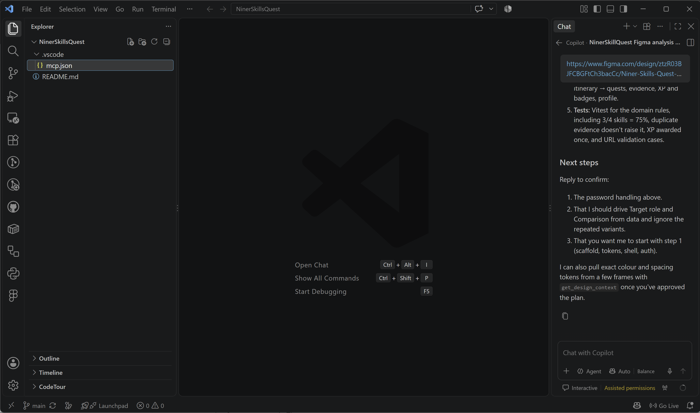
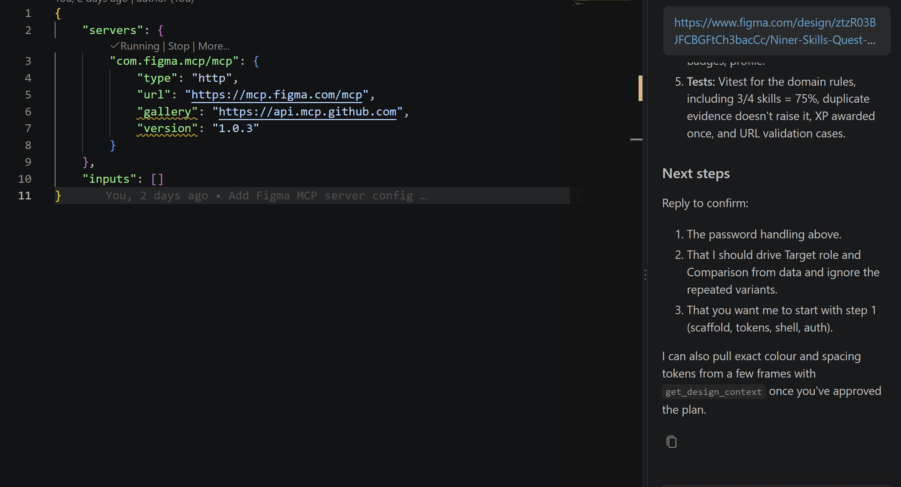
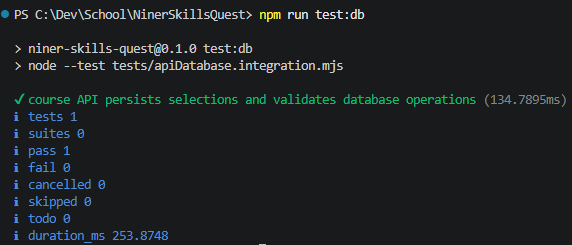

# Individual Contribution Details

## Contributor

**Jed Duncan**

This file records my individual assignment details separately from the shared
links in [assignment-deliverables.md](../assignment-deliverables.md).

## My development contributions

My work for this submission included:

- Establishing the application foundation and illustrative course catalog.
- Implementing the completed-course workflow and browser persistence.
- Aligning the course-entry UI with the Figma design.
- Verifying the course workflow and documenting testing and handoff notes.
- Updating the course action label to “Check save status.”
- Adding individual GitHub Education, Copilot, and Figma MCP screenshots.
- Developing a Prisma persistence model and database-backed course workflow
  on the separate `databasetesting-jed` branch. This branch is now defunct.

## Individual implementation evidence

### Completed-course workflow

The application supports course search, course selection, duplicate
prevention, removal, derived skill display, and persistence. My original
implementation used browser storage; the current `database_setup` branch
persists completed courses through the Prisma API and PostgreSQL.

Supporting documents:

- [Issue #1 plan](../issue_details/issue-1-plan.md)
- [Issue #1 test results](../issue_details/issue-1-test-results.md)
- [Issue #1](https://github.com/kgajula1-stack/NinerSkillsQuest/issues/1)
- [PR #20](https://github.com/kgajula1-stack/NinerSkillsQuest/pull/20)

### Course-entry design

The course-entry UI was aligned with the Figma course panel, including the
course selector, course preview, suggested-skill chips, and added-items
section. The implementation and verification are recorded in commits
`de4c266` and `4bb1939`.

## Individual tooling and evidence

### GitHub Education



### GitHub Copilot and VS Code



### Figma MCP



## Individual testing evidence

The recorded validation for the original completed-course workflow was:

```text
npm test      -> Passed: 2 test files, 10 tests
npm run build -> Passed: TypeScript check and Vite production build
```

Acceptance criteria verified:

- Students can search for, add, and remove supported completed courses.
- Duplicate course selections are prevented.
- Mapped skills update when courses are added or removed.
- Browser refresh restores saved selections.
- Invalid saved data and storage failures produce recoverable messages.
- Course selection and removal work with keyboard navigation.

See [Issue #1 test results](../issue_details/issue-1-test-results.md) for the recorded
browser demonstration and automated test coverage.

## Database setup and verification

The local PostgreSQL database was configured for Prisma, initialized with the
committed migration, and populated with the illustrative reference data using
the seed script. See the [database setup guide](../database-setup.md) for the
connection configuration and setup commands.

The database API integration test passed:

```text
npm run test:db -> Passed: 1 test
```

The test verified that course selections persist and that database operations
are validated.


## Individual completion checklist

- [x] Individual contribution details documented
- [x] Completed-course implementation and testing evidence linked
- [x] GitHub Education evidence included
- [x] Copilot and VS Code evidence included
- [x] Figma MCP evidence included
- [x] Separate database development work documented
- [ ] Team database connection and operations verified
- [ ] Current database verification screenshot added
- [ ] Sprint 2 contribution linked to the final submission issue or pull request
