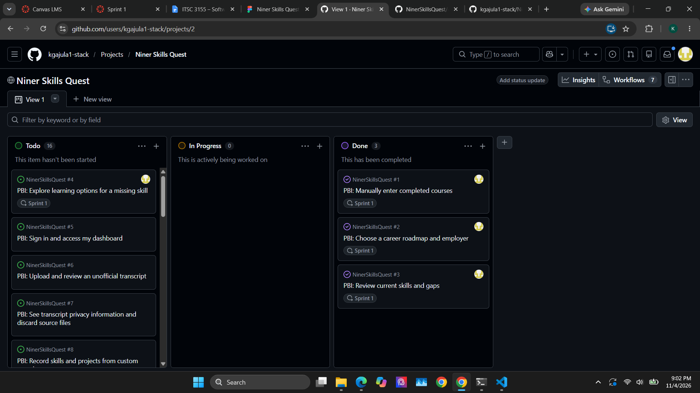
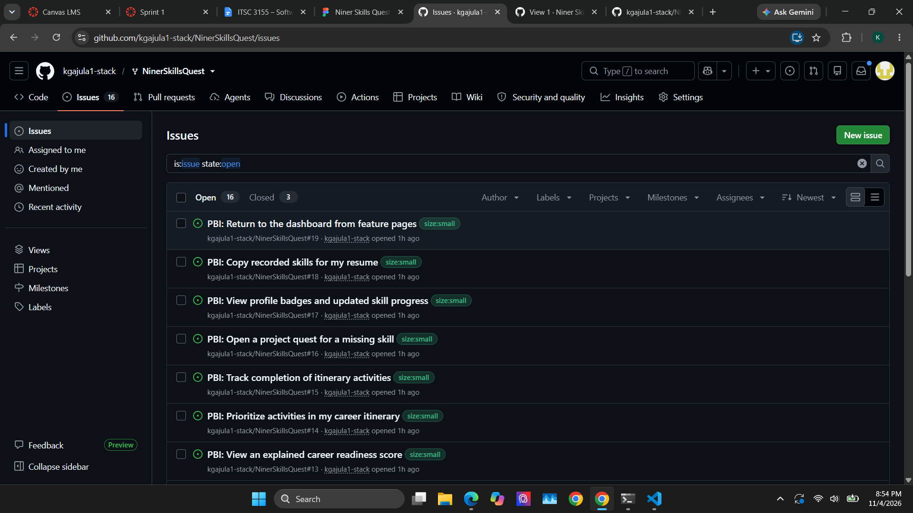
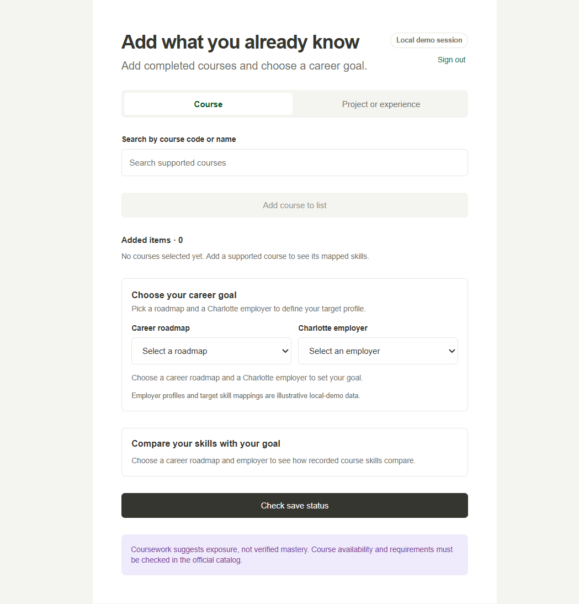
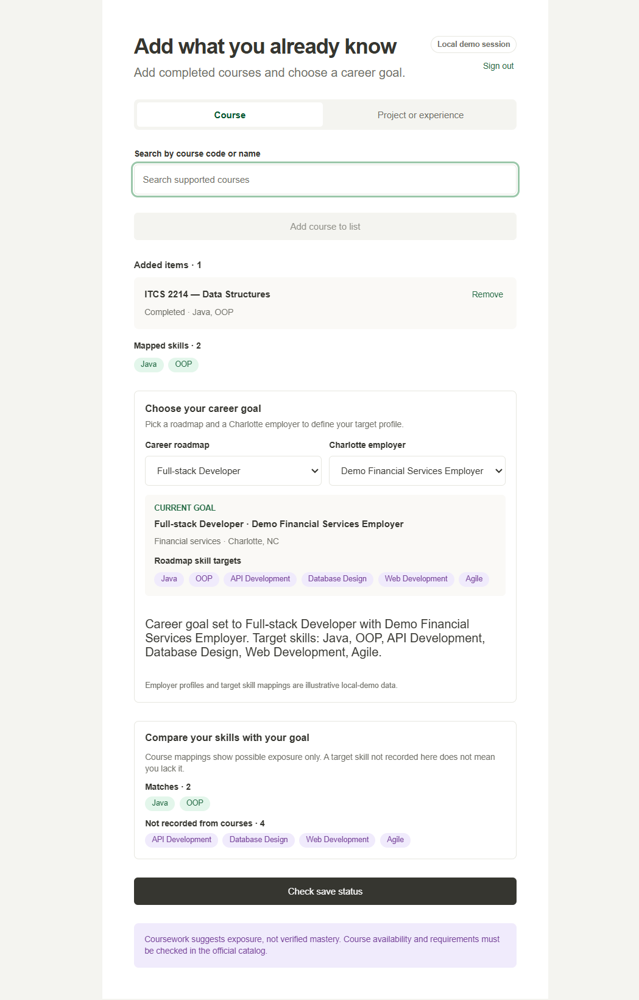
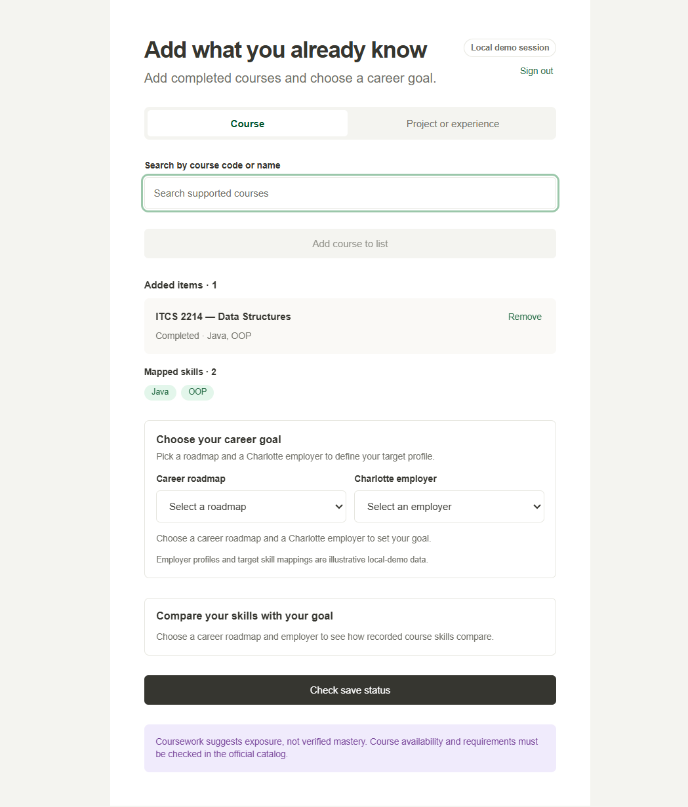
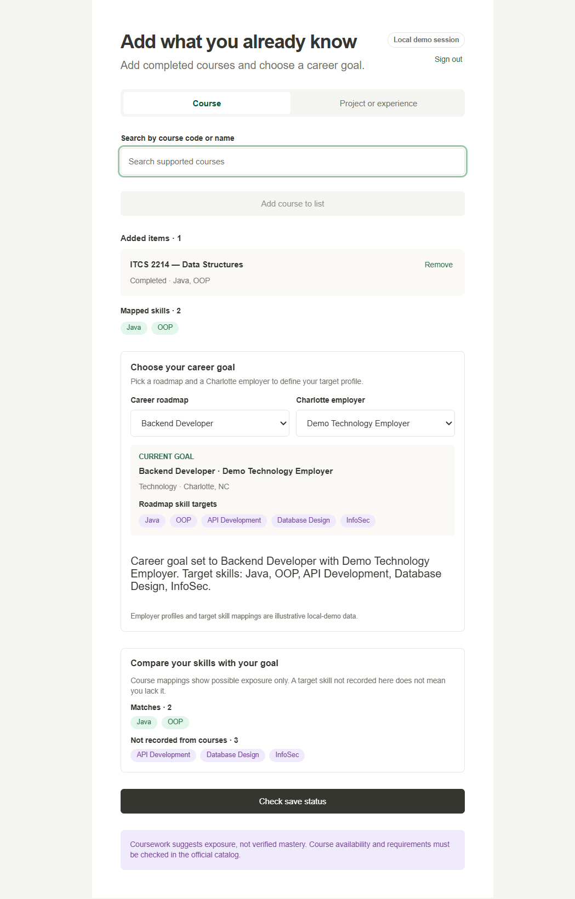
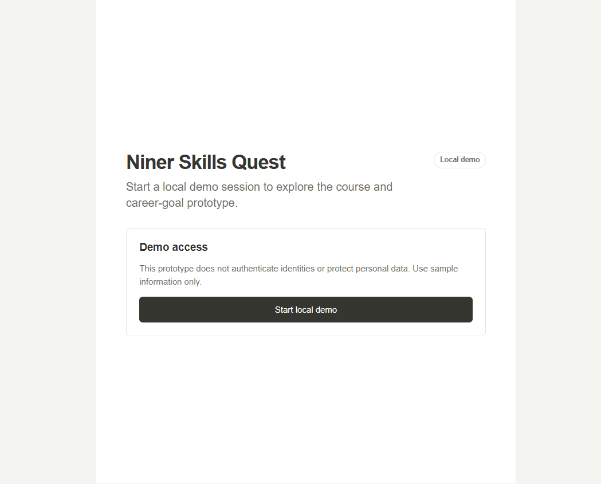

# ITSC 3155 Lab Deliverables

## Niner Skills Quest

Niner Skills Quest is a browser-based career-planning prototype for UNC
Charlotte students. Students can record completed courses, review the skills
mapped to those courses, select a career roadmap and Charlotte employer, and
compare recorded course skills with career-goal targets.

This submission demonstrates the transition from user stories and Figma design
to a working Sprint 1 implementation. The current application is a local demo
using illustrative course mappings and fictional employer profiles. Course
mappings represent possible exposure, not verified mastery.

---

## Submission links

| Resource | Link |
| --- | --- |
| Repository | [kgajula1-stack/NinerSkillsQuest](https://github.com/kgajula1-stack/NinerSkillsQuest) |
| GitHub Issues | [Repository issues](https://github.com/kgajula1-stack/NinerSkillsQuest/issues) |
| GitHub Project | [Niner Skills Quest Project](https://github.com/users/kgajula1-stack/projects/2) |
| Figma prototype | [Niner Skills Quest — node 69:103](https://www.figma.com/design/LpfH5WzheMLebrh6dr7jyA/Niner-Skills-Quest?node-id=69-103&t=sW2OVDTOKIzr2C4g-0) |
| Completed-course issue | [Issue #1](https://github.com/kgajula1-stack/NinerSkillsQuest/issues/1) |
| Career-goal issue | [Issue #2](https://github.com/kgajula1-stack/NinerSkillsQuest/issues/2) |
| Skill-comparison issue | [Issue #3](https://github.com/kgajula1-stack/NinerSkillsQuest/issues/3) |
| Completed-course pull request | [PR #20](https://github.com/kgajula1-stack/NinerSkillsQuest/pull/20) |
| Skill-comparison pull request | [PR #21](https://github.com/kgajula1-stack/NinerSkillsQuest/pull/21) |

---

## Implemented functionality

### Completed-course workflow

Students can search the supported catalog by course code or title, add a
completed course, view its suggested skills, and remove it later. The
application prevents duplicate selections, derives a deduplicated skill list,
and persists course IDs in browser storage.

Evidence:

- [Completed-course screenshot](./screenshots/issue-1-completed-courses.png)
- [Course-entry plan](./issue-1-plan.md)
- [Course-entry test results](./issue-1-test-results.md)

### Career-goal selection

Students can select a career roadmap and a Charlotte employer. A completed
goal displays the selected roadmap, employer details, and target skills. Both
selections persist locally and can be changed independently.

Evidence:

- [Career-goal screenshot](./screenshots/issue-2-career-goal.png)
- [Career-goal plan](./issue-2-plan.md)
- [Career-goal test results](./issue-2-test-results.md)

### Skill comparison

The application compares skills derived from completed courses with the
selected roadmap's target skills. It separates matches from skills not
recorded by the current course list and explicitly avoids treating unrecorded
skills as proof that a student lacks them.

Evidence:

- [Skill-comparison screenshot](./screenshots/issue-3-skill-comparison.png)
- [Skill-comparison test results](./issue-3-test-results.md)

### Local demo session

The prototype has a clearly labeled local demo access screen. It does not
authenticate identities or isolate data between real student accounts.

Evidence:

- [Demo-session screenshot](./screenshots/issue-5-demo-session.png)

---

## Sprint 1 evidence

The Sprint 1 board contains the completed implementation issues in the Done
column and identifies them with the Sprint 1 iteration.



The repository issue list shows the product backlog and sizing labels:



Supporting planning documents:

- [Issue #1 plan](./issue-1-plan.md)
- [Issue #2 plan](./issue-2-plan.md)
- [Issue #3 test results](./issue-3-test-results.md)

---

## Development environment and AI-assisted development

The project was developed in Visual Studio Code using GitHub Copilot and
Copilot Chat. Copilot was used to help understand the repository structure,
implement features, create tests, and prepare documentation. The team
reviewed, tested, and verified the generated work.

Evidence:

- [Copilot account verification](./screenshots/copilotaccountverification.png)
- [Copilot functionality in VS Code](./screenshots/copilotVerfication.png)
- [README AI-use disclosure](../README.md#ai-use-disclosure)

The project stack is:

- TypeScript
- Vite
- Vitest
- Vanilla browser DOM APIs
- CSS
- Browser `localStorage` and `sessionStorage`

---

## Figma MCP status

The Figma MCP connection is authenticated for the account associated with this
submission. The authenticated plan reports Code Layers enabled.

The requested design file and node are:

- File key: `LpfH5WzheMLebrh6dr7jyA`
- Node: `69:103`
- [Open the Figma frame](https://www.figma.com/design/LpfH5WzheMLebrh6dr7jyA/Niner-Skills-Quest?node-id=69-103&t=sW2OVDTOKIzr2C4g-0)

The Figma MCP Starter plan rate limit prevented retrieval of design context and
a node screenshot during this session. The course-entry implementation still
follows the supplied design's compact layout, segmented entry tabs, course
preview, status chips, suggested-skill chips, added-items section, and purple
notice. The career-goal controls follow the application's existing form and
card patterns rather than claiming pixel-perfect alignment with an
uninspectable frame.

---

## Testing and verification

From the repository root:

```sh
npm install
npm test
npm run build
```

Latest automated verification:

| Check | Result |
| --- | --- |
| `npm test` | Passed — 5 test files, 27 tests |
| `npm run build` | Passed — TypeScript check and Vite production build |

The automated tests cover:

- Course, skill, and roadmap catalog integrity
- Duplicate course prevention
- Skill deduplication and overlap-safe removal
- Empty states
- Course and career-goal persistence
- Invalid saved-data recovery
- Browser-storage read/write failures
- Missing, empty, matched, and unmatched skill comparisons
- Demo-session start, restore, and sign-out behavior

Additional verification documents:

- [Completed-course verification](./issue-1-test-results.md)
- [Career-goal verification](./issue-2-test-results.md)
- [Skill-comparison verification](./issue-3-test-results.md)

---

## Application evidence gallery

### Empty state



### Course and career-goal workflow



### Completed course



### Career goal



### Skill comparison


### Local demo access



---

## Limitations and future work

The current submission is intentionally a local prototype. It does not yet
include:

- Real authentication or account isolation
- Backend services
- Transcript upload
- Official catalog data
- Verified employer requirements
- Verified skill mastery
- Project or experience entry

These limitations are also documented in the [README](../README.md).

## Final submission checklist

- [x] Repository URL included
- [x] GitHub Issues URL included
- [x] GitHub Project URL included
- [x] Figma prototype URL included
- [x] Implemented issue links included
- [x] Pull request links included
- [x] Copilot access verified
- [x] VS Code and Copilot functionality verified
- [x] Sprint 1 board evidence included
- [x] Working feature implemented
- [x] Browser feature evidence included
- [x] Automated tests and production build documented
- [x] README setup, usage, testing, limitations, and AI disclosure included
- [ ] Figma MCP design-context screenshot pending Starter plan rate-limit reset
