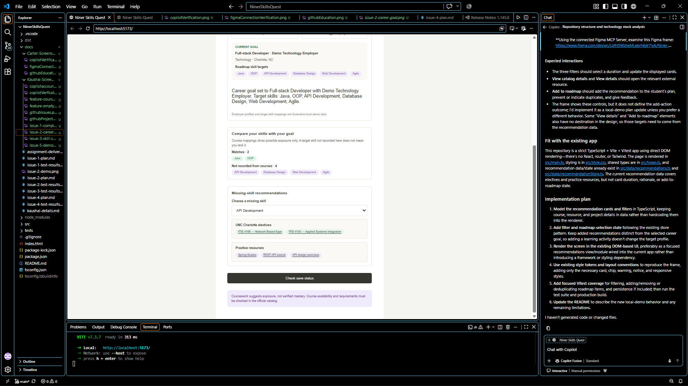

# Individual Contribution Details

## Contributor

**Carter Hofmann**

This file records my individual assignment details for Issue #4, separate
from the shared links in [assignment-deliverables.md](./assignment-deliverables.md).

## Individual implementation evidence

### Missing-skill recommendations

The recommendation feature lets students select a skill not recorded by their
current course mappings and review relevant UNC Charlotte electives and
online practice resources. Recommendations are curated demo data, not official
academic guidance or evidence of verified skill mastery. The interface
provides a missing-skill selector, recommendation groups, resource links, and
an empty state when recommendations are unavailable.



- [Issue #4 plan](./issue-4-plan.md)
- [Issue #4 test results](./issue-4-test-results.md)

## Individual testing evidence

The recorded validation for Issue #4 was:

```text
npm test      -> Passed: 7 test files, 32 tests
npm run build -> Passed
```

Acceptance criteria verified:

- Students can select a missing skill and see related learning options.
- Recommendations include electives and practice resources for supported
  skills.
- Online resources have usable links.
- The interface displays an empty state when recommendations are unavailable.
