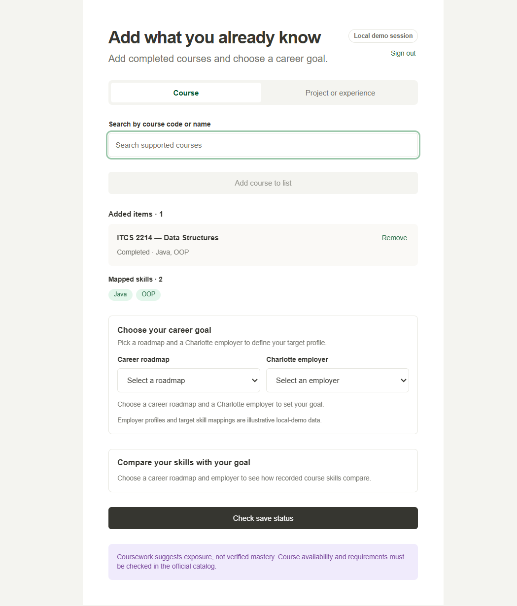
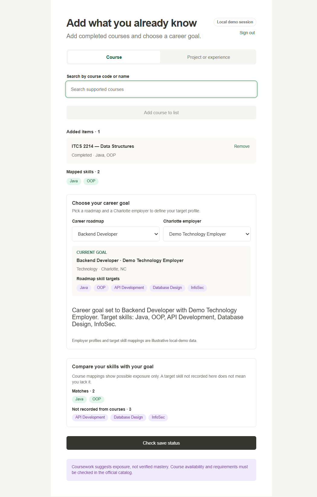
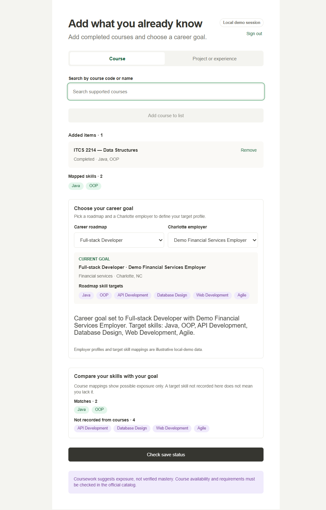
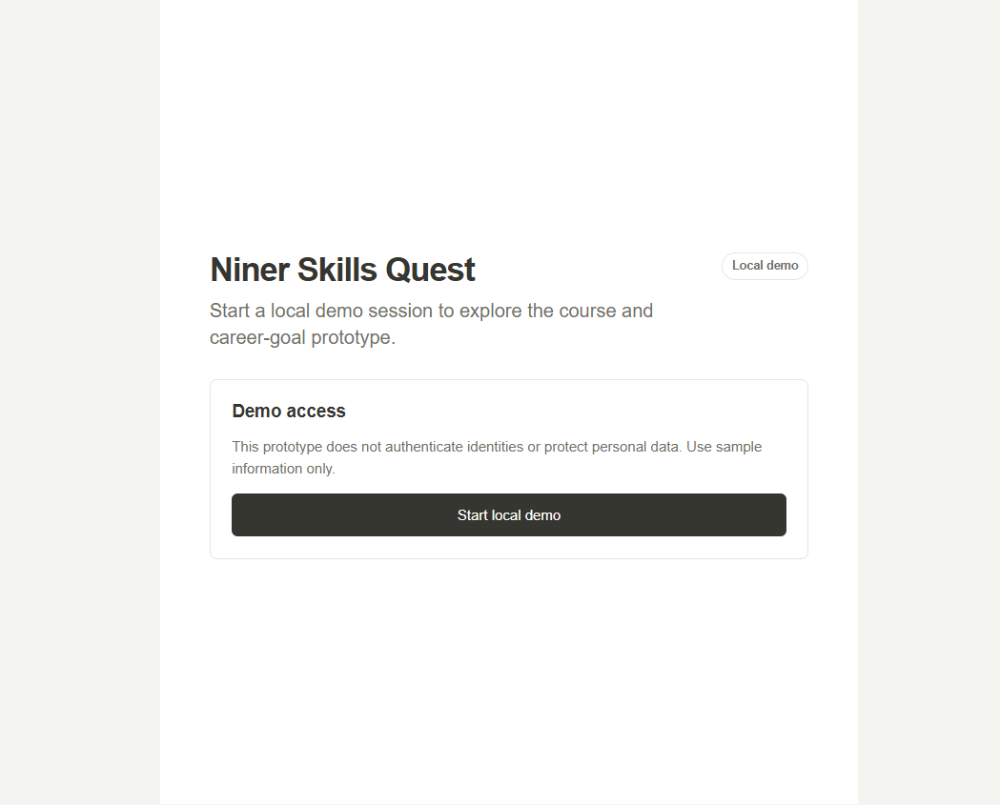

# Individual Contribution Details

## Contributor

**Kaushal Gajula**

This file records my individual assignment details separately from the shared
links in [assignment-deliverables.md](./assignment-deliverables.md).

## My development contributions

My work for this submission included:

- Working in the Niner Skills Quest repository and validating its project
  structure and technology stack.
- Implementing and verifying the completed-course workflow.
- Implementing and verifying career-roadmap and employer selection.
- Implementing and verifying course-to-target skill comparison.
- Verifying the local demo-session flow.
- Reviewing and documenting accessibility behavior, persistence, invalid-data
  handling, and browser-storage failures.
- Running the automated test suite and production build.
- Preparing the assignment deliverables and evidence documentation.
- Using GitHub Copilot and Copilot Chat to assist with implementation, testing,
  repository analysis, and documentation, followed by review and verification.

## Individual implementation evidence

### Completed-course workflow

The application supports course search, course selection, duplicate
prevention, removal, derived skill display, and local persistence.



Supporting documents:

- [Issue #1 plan](./issue-1-plan.md)
- [Issue #1 test results](./issue-1-test-results.md)
- [Issue #1](https://github.com/kgajula1-stack/NinerSkillsQuest/issues/1)
- [PR #20](https://github.com/kgajula1-stack/NinerSkillsQuest/pull/20)

### Career-goal selection

The application supports selecting a career roadmap and Charlotte employer,
displaying target skills, changing either selection, and persisting the goal.



Supporting documents:

- [Issue #2 plan](./issue-2-plan.md)
- [Issue #2 test results](./issue-2-test-results.md)
- [Issue #2](https://github.com/kgajula1-stack/NinerSkillsQuest/issues/2)

### Skill comparison

The application separates target skills matched by recorded course mappings
from target skills not recorded by the current course list. Unrecorded skills
are not presented as proof that a student lacks those skills.



Supporting documents:

- [Issue #3 test results](./issue-3-test-results.md)
- [Issue #3](https://github.com/kgajula1-stack/NinerSkillsQuest/issues/3)
- [PR #21](https://github.com/kgajula1-stack/NinerSkillsQuest/pull/21)

### Local demo session

The local demo access and sign-out flow are clearly labeled and do not claim
to authenticate real student identities.



## Individual tooling and evidence

### GitHub Copilot and VS Code

GitHub Copilot access and Copilot Chat functionality were verified in Visual
Studio Code. Copilot helped with repository analysis, implementation,
testing, and documentation. Generated work was reviewed and validated.

- [Copilot account verification](./screenshots/copilotaccountverification.png)
- [Copilot functionality](./screenshots/copilotVerfication.png)

### Figma MCP

The Figma MCP connection was authenticated for the Figma account used during
development. Code Layers were enabled on the Starter plan. Design-context
retrieval for the requested node was rate-limited during the session.

- [Figma prototype — node 69:103](https://www.figma.com/design/LpfH5WzheMLebrh6dr7jyA/Niner-Skills-Quest?node-id=69-103&t=sW2OVDTOKIzr2C4g-0)

## Individual testing evidence

The latest recorded validation was:

```text
npm test   -> Passed: 5 test files, 27 tests
npm run build -> Passed: TypeScript check and Vite production build
```

Additional browser evidence:

- [Empty-state screenshot](./screenshots/feature-empty-state.png)
- [Combined course and goal screenshot](./screenshots/feature-course-and-goal.png)
- [GitHub Issues screenshot](./screenshots/githubIssues.png)
- [Sprint 1 Project screenshot](./screenshots/githubProjectboard.png)

## Individual completion checklist

- [x] Individual contribution details documented
- [x] Completed-course evidence linked
- [x] Career-goal evidence linked
- [x] Skill-comparison evidence linked
- [x] Local demo-session evidence linked
- [x] Copilot and VS Code evidence linked
- [x] Testing and build results documented
- [x] Figma prototype link included
- [ ] Figma MCP design-context screenshot pending rate-limit reset

